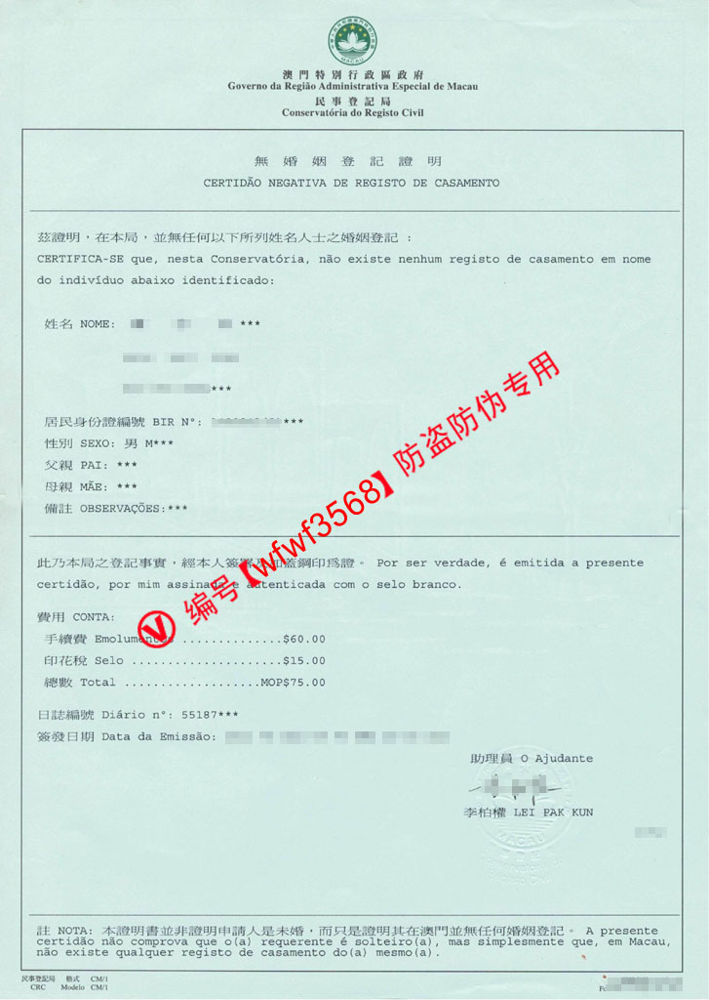
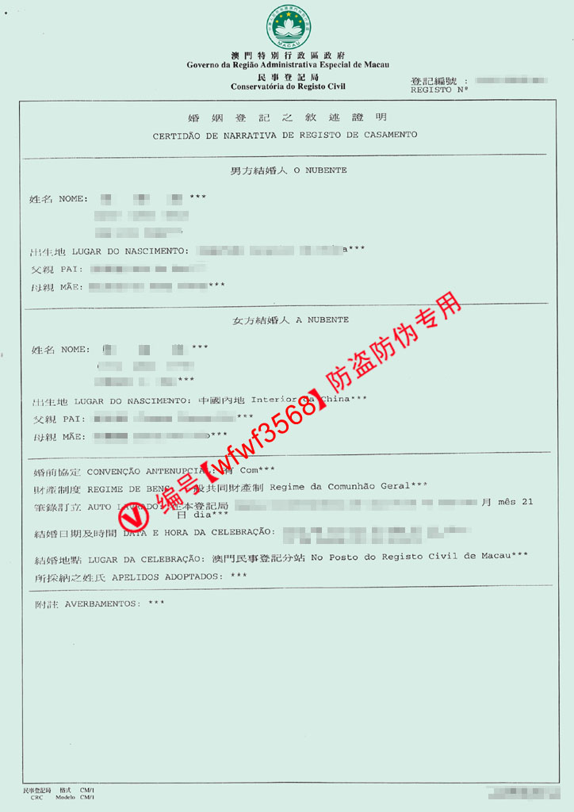

# 澳门婚姻登记之叙述证明、无结婚纪录证明书样本及办理在内地使用指南

澳门居民在内地办理结婚登记、房产买卖、子女落户，甚至申请签证或处理遗产继承，常常会被办事窗口要求出示婚姻状况证明。很多朋友拿到澳门民事登记局签发的证明文件后，看着满纸的中葡双语和专业术语一头雾水，甚至带回内地才发现用不了。结合手头这两份真实的官方样本，我们把《无婚姻登记证明》和《婚姻登记之叙述证明》的排版细节、核心条款以及回内地使用的全套避坑流程彻底理清楚。

先看第一张图，这份文件顶部印着澳门特别行政区区徽，抬头写着“澳门特别行政区政府 民事登记局”，标题为《无婚姻登记证明》（葡文：CERTIDÃO NEGATIVA DE REGISTO DE CASAMENTO），也就是大家常说的“单身证明”或“寡佬证”。仔细观察样张正文，开头写着“兹证明，在本局，并无任何以下所列姓名人士之婚姻登记”，下面列出了申请人的中葡文姓名、居民身份证编号（BIR N°）、性别以及父母姓名。重点看样张最底部那行小字“注 NOTA”：“本证明书并非证明申请人是未婚，而只是证明其在澳门并无任何婚姻登记。”这句话直接点破了澳门法律体系与内地的核心差异——澳门民事登记局只对本地登记系统里有没有记录负责，如果你曾在其他国家或地区领过证但没在澳门做过登记，这张纸照样能开出来。样张中下部清晰列出了收费明细：手续费（Emolumento）60澳门元，印花税（Selo）15澳门元，总计MOP$75.00，右下角有民事登记局助理员的亲笔签名与钢印，这才是官方正本的防伪标志。

  
   
  ▲ 澳门无结婚纪录证明（单身证明）样本（点击图片查看高清大图）
 

再看第二张图，这是已经结了婚的人士需要用到的《婚姻登记之叙述证明》（葡文：CERTIDÃO DE NARRATIVA DE REGISTO DE CASAMENTO）。相比第一张单身证明，这张绿色防伪底纹的纸张信息量要大得多，顶部右上角多了一个关键的“登记编号（REGISTO N°）”。正文分成了“男方结婚人”和“女方结婚人”两大板块，详细记录了双方的姓名、出生地（比如样张里女方标注为“中国内地 Interior da China”）以及双方父母的姓名。继续往下看样张的下半部分，这里藏着内地办事机构最看重的几个法律细节：文件明确记载了“婚前协定”状况（样张显示为“有 Com”）、“财产制度”（样张显示为“一般共同财产制 Regime da Comunhão Geral”）、结婚日期时间以及结婚地点（澳门民事登记分站）。一旦夫妻双方回内地涉及房产交易、银行贷款或离婚财产分割，内地房管局和公证处一定会死盯这一栏的财产制约定。如果双方在澳门登记时选了“一般共同财产制”或“取得财产分享制”，在内地卖房就必须夫妻双方共同签字，哪怕房产证上只写了单个人的名字也不行。

  
   
  ▲ 婚姻登记之叙述证明（结婚证）样本（点击图片查看高清大图）
 

## 澳门开具的婚姻证明为什么不能直接拿回内地用？

很多澳门居民以为拿着民事登记局盖了钢印的原件，就能直接去内地民政局领证或者去房管局过户，结果往往在窗口吃闭门羹。因为澳门实行的是独立法律体系，内地政府部门、法院、公证处无法直接核实澳门民事登记局助理员签名的真伪，也没有联网系统可以交叉核对。

根据现行规定，澳门出具的各类民事证明文件，必须经过“中国法律服务（澳门）有限公司”加盖“转递专用章”，也就是俗称的“澳门公证转递”程序，才能在内地产生法律效力。缺少这个转递章，你在澳门开的《无婚姻登记证明》或《婚姻登记之叙述证明》，在内地办事窗口眼里就是一张无法采信的普通外地纸张。

## 申请澳门无结婚纪录证明需要准备什么材料？

在澳门申请这两份证明其实非常快，本人亲自前往水坑尾街公共行政大楼二楼的民事登记局即可办理，也可以通过“一户通”手机App提前预约减少排队。办理《无婚姻登记证明》时，申请人需要带齐澳门居民身份证正本；如果本人不在澳门，允许委托亲友代办，但受托人必须出示自己的身份证件、申请人的身份证副本，以及写明授权事项的委托书。

如果是申请《婚姻登记之叙述证明》，除了出示夫妻任一方的澳门居民身份证，最好能提供当年的结婚登记编号或准确结婚日期，方便柜台职员快速调档。现场缴费就是样张上显示的那样，统一收取75澳门元，支持澳门元现金、澳门通或电子支付，通常在递交申请后的五个工作日内就能拿到带有钢印的正式文书。

## 澳门公证与转递流程具体该怎么走？

拿到民事登记局签发的原件后，下一步就要找具备资格的“中国委托公证人（澳门）”办理公证手续。目前澳门拥有多名由国家司法部委托的执业律师，他们专门负责核实澳门本地文件的真实性，并出具《声明书》或《证明书》。

具体操作分三步走，一步都不能乱：

1. **预约委托公证人**：带着刚开出来的《无婚姻登记证明》或《婚姻登记之叙述证明》原件、澳门居民身份证、回乡证（港澳居民来往内地通行证）原件，前往任意一家有委托公证人资格的澳门律师事务所。
2. **现场签署声明**：如果是回内地结婚，公证人会让你现场签署一份《申请结婚声明书》，声明自己目前确实无配偶，且与内地结婚对象没有直系血亲或三代以内旁系血亲关系，并将你的《无婚姻登记证明》作为附件装订在一起。
3. **转递机构加盖骑缝章**：委托公证人制作好公证文书后，会将整套文件送交“中国法律服务（澳门）有限公司”审核。审核通过后，公司会在文件上加盖红色的“中华人民共和国司法部委托公证人（澳门）办理之文书转递专用章”，正本交还给你带回内地，副本则会直接寄往你指定的内地使用机构（比如某市婚姻登记处）。

## 办理过程中最容易踩的五个实操大坑

在实际经手这类跨境业务时，很多人因为不懂门道白白跑了好几趟，甚至耽误了婚期和房产交割，下面这五个细节务必提前核对清楚：

* **忽略证明书的有效期**：内地民政部门和公证处对《无婚姻登记证明》的时效卡得非常死，绝大多数城市要求证明自签发之日起“六个月内”有效，部分严格地区甚至要求“三个月内”。千万别提前半年就把单身证明开出来放着，等凑齐时间回内地领证时文件已经过期，只能重新缴费再开一次。
* **搞错“内地使用机构”的具体名称**：做公证转递时，律师楼一定会问你这份文件拿到内地哪个城市、哪个具体部门使用。因为转递机构要把公证文书的副本直接邮寄给对应的接收单位，如果你把“XX市民政局涉外婚姻登记处”写成了“XX区民政局”，副本寄错了地方，内地窗口在系统里查不到备案，照样拒绝受理。
* **离异或丧偶人士只开无婚证明**：如果你曾经在澳门或外地结过婚，后来离婚或配偶过世，单凭一张《无婚姻登记证明》是绝对不够的。澳门民事登记局的结婚档案里依然留有历史记录，这种情况下必须同时申请带有离婚附注的《婚姻登记之叙述证明》，或者提供法院的离婚判决书确定证明书，连同单身声明一并公证。
* **姓名曾用名或中葡文拼写不一致**：澳门居民身份证上的葡文拼音、繁体字，有时与早年办理内地房产证或银行账户时登记的简体字、汉语拼音存在细微出入。在找委托公证人起草文书时，一定要把旧证件带过去，让公证人在文书里把“同属一人”的关联信息写进去，省得回内地还要额外开具“同一人声明书”。
* **没留足转递时间导致行程泡汤**：澳门民事登记局出证需要5个工作日，委托公证人制作文书加转递机构审核盖章通常还需要5到7个工作日，遇上节假日还要顺延。如果急着回内地赶婚期或办过户，建议至少提前三周启动办理，必要时可以向律师楼询问加急转递服务。
